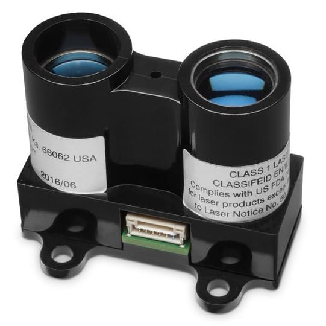
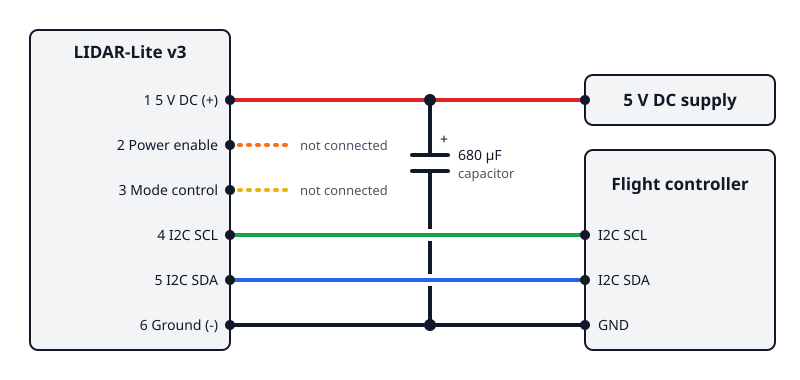
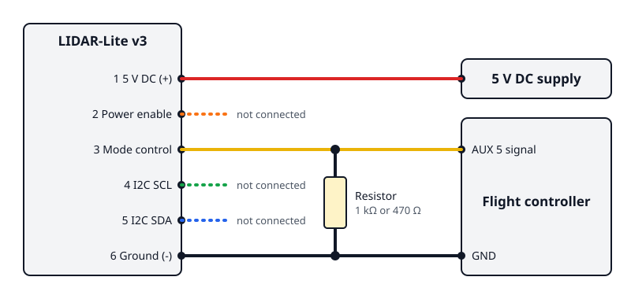

# Garmin LIDAR-Lite

<Badge type="tip" text="PX4 v1.1" />

The [Garmin LIDAR-Lite v3](https://www.garmin.com/en-US/p/557294/) is a compact laser time-of-flight [rangefinder](../sensor/rangefinders.md) with a range of up to 40 m (PX4 caps this to 35 m or less).
It connects to the flight controller using either I2C or PWM.



:::info
The driver for the PWM connection is not included in PX4 firmware by default.
See [Firmware Support](#firmware_support) for how to check your board and add it.
:::

## Supported Models {#supported_models}

| Модель                                                  | Діапазон   | Підключення | Примітки                                    |
| ------------------------------------------------------- | ---------- | ----------- | ------------------------------------------- |
| [LIDAR-Lite v3](https://www.garmin.com/en-US/p/557294/) | Up to 40 m | I2C, PWM    |                                             |
| LIDAR-Lite v3HP                                         |            | I2C         |                                             |
| LIDAR-Lite v4 LED                                       |            | I2C         | PX4 caps the range to 10 m. |
| LIDAR-Lite v2                                           |            | I2C, PWM    |                                             |
| LIDAR-Lite v1                                           |            | I2C, PWM    |                                             |

The rest of this page describes the LIDAR-Lite v3, unless otherwise stated.

## Specifications {#specifications}

The following specifications are for the LIDAR-Lite v3.

- **Technology:** Laser time-of-flight (905 nm)
- **Range:** Up to 40 m (70% reflective target)
- **Update rate:** 270 Hz typical, 650 Hz in fast mode (PX4 samples at up to 100 Hz on I2C, and at 20 Hz on PWM)
- **Beam divergence:** 8 mrad
- **Accuracy:** ±2.5 cm typical below 5 m, ±10 cm typical at 5 m and above
- **Resolution:** ±1 cm
- **Interface:** I2C (address `0x62`), PWM
- **Input voltage:** 5 V DC nominal (4.5–5.5 V)
- **Current draw:** 105 mA idle, 135 mA in continuous operation
- **Dimensions:** 20 x 48 x 40 mm
- **Weight:** 22 g
- **Operating temperature:** -20 to 60 °C
- **Laser class:** Class 1

## Where to Buy {#store}

- [LIDAR-Lite v3](https://www.garmin.com/en-US/p/557294/) (Garmin)

## Hardware Setup {#hardware_setup}

### Mounting {#mounting}

PX4 assumes that the rangefinder is facing down (the orientation cannot be configured).

### Pinouts {#pinouts}

The LIDAR-Lite v3 has a 6-pin connector that mates with a JST GH housing (`GHR-06V-S`, 1.25 mm pitch).

| Pin | Wire colour | Сигнал                        | Опис                                                                                                                             |
| --- | ----------- | ----------------------------- | -------------------------------------------------------------------------------------------------------------------------------- |
| 1   | Red         | 5 V DC (+) | Power supply. 5 V DC nominal (4.5–5.5 V).     |
| 2   | Orange      | Power enable                  | Internal pull-up. Can be driven low to shut off power to the sensor.                             |
| 3   | Yellow      | Mode control                  | PWM interface: pull low to trigger a measurement; returns a pulse (10 μs/cm). |
| 4   | Зелений     | I2C SCL                       | I2C clock                                                                                                                        |
| 5   | Синій       | I2C SDA                       | I2C data                                                                                                                         |
| 6   | Black       | Ground (-) | Signal and power ground                                                                                                          |

### Wiring {#wiring}

The LIDAR-Lite v3 can be connected using either I2C or PWM.
Older LIDAR-Lite generations (v1 and v2) were reported to have I2C problems, and PWM was recommended for them.

The sensor requires a 5 V DC supply, and draws up to 135 mA in continuous operation.
Check that the flight controller port can supply this, or power the sensor from a separate supply that shares a ground with the flight controller.

#### I2C {#wiring_i2c}

Connect the sensor to an external `I2C` port on the flight controller.



| LIDAR-Lite v3 pin              | Wire colour | Connect to                |
| ------------------------------ | ----------- | ------------------------- |
| 1 (5 V DC)  | Red         | 5 V DC supply             |
| 4 (I2C SCL) | Зелений     | Flight controller I2C SCL |
| 5 (I2C SDA) | Синій       | Flight controller I2C SDA |
| 6 (Ground)  | Black       | Flight controller GND     |

Pins 2 (power enable) and 3 (mode control) are not connected.

Garmin's standard I2C wiring also requires a 680 μF electrolytic capacitor between the 5 V DC and ground wires (observe the polarity).

The sensor uses the I2C address `0x62`.

#### PWM {#wiring_pwm}

:::info
The PWM connection is not as well tested as I2C.
:::

PX4 reads the sensor's PWM output on the flight controller's PWM input pin.
On Pixhawk flight controllers this is FMU output 5 (`AUX 5`, or `MAIN 5` on flight controllers that have no AUX port).
The pin is fixed.



| LIDAR-Lite v3 pin                   | Wire colour | Connect to                                                                      |
| ----------------------------------- | ----------- | ------------------------------------------------------------------------------- |
| 1 (5 V DC)       | Red         | 5 V DC supply                                                                   |
| 3 (Mode control) | Yellow      | `AUX 5` signal pin, and to ground through a resistor (below) |
| 6 (Ground)       | Black       | Flight controller GND                                                           |

Pins 2 (power enable), 4 (I2C SCL) and 5 (I2C SDA) are not connected.

The mode control pin must be connected to ground through a resistor, which makes the sensor measure continuously.
The Garmin specification is for a 1 kΩ resistor, but a 470 Ω resistor was found to be needed when tested with PX4 on a Pixhawk.

The driver also uses FMU output 6 (`AUX 6`), so this output cannot be used for anything else.

## Firmware Support {#firmware_support}

The rangefinder is supported by a different driver for each connection, as described below.

To check your board, look for the keys in its [board configuration](../hardware/porting_guide_config.md) file, `boards/<vendor>/<board>/default.px4board`.

If a driver is missing, add its key to the board's `default.px4board` file, or enable it in [boardconfig](../hardware/porting_guide_config.md#px4-menuconfig-setup) under **Drivers > Distance sensors**, and then [build and upload the firmware](../dev_setup/building_px4.md).

The drivers do not start until they are enabled using the parameter in [PX4 Configuration](#px4_configuration).

### I2C {#firmware_support_i2c}

The driver is [ll40ls](../modules/modules_driver_distance_sensor.md#ll40ls), which is built into firmware by either of the following keys:

- `CONFIG_COMMON_DISTANCE_SENSOR=y`: the common set of rangefinder drivers, which includes this one.
- `CONFIG_DRIVERS_DISTANCE_SENSOR_LL40LS=y`: this driver on its own.

Most boards set `CONFIG_COMMON_DISTANCE_SENSOR`, so the I2C driver is present in most firmware.

### PWM {#firmware_support_pwm}

The driver is [ll40ls_pwm](../modules/modules_driver_distance_sensor.md#ll40ls-pwm), which is built into firmware by the key `CONFIG_DRIVERS_DISTANCE_SENSOR_LL40LS_PWM=y`.
It is not part of the common set of rangefinder drivers, so it is only present in the firmware for boards that set that key.

The PWM driver also requires the `pwm_input` driver (`CONFIG_DRIVERS_PWM_INPUT=y`).

## PX4 Configuration {#px4_configuration}

The rangefinder is enabled using the parameter [SENS_EN_LL40LS](../advanced_config/parameter_reference.md#SENS_EN_LL40LS).
The value to set depends on the connection, as described below.
Reboot the flight controller after changing the parameter.

If the parameter is not available in _QGroundControl_ then the I2C driver is not in the firmware: see [Firmware Support](#firmware_support).

The configuration that is common to all rangefinders, such as the sensor position offsets used by the estimator, is covered in [Rangefinders > Configuration/Setup](../sensor/rangefinders.md#configuration).

### I2C {#px4_configuration_i2c}

Set [SENS_EN_LL40LS](../advanced_config/parameter_reference.md#SENS_EN_LL40LS) to `2`.

The driver detects the hardware version of the connected sensor, and uses this to set the maximum range that PX4 will use:

- LIDAR-Lite v4 LED: 10 m
- Other versions: 25 m or 35 m, depending on the detected hardware version

The minimum range is 5 cm.

### PWM {#px4_configuration_pwm}

Set [SENS_EN_LL40LS](../advanced_config/parameter_reference.md#SENS_EN_LL40LS) to `1`.

PX4 uses a range of 5 cm to 25 m for all versions of the sensor.

## Testing {#testing}

You can check that the driver is running using the _QGroundControl MAVLink Console_.
For I2C:

```sh
ll40ls status
```

For PWM:

```sh
ll40ls_pwm status
```

You can observe the published measurements with:

```sh
listener distance_sensor
```

The measurements can also be viewed in the `DISTANCE_SENSOR` message in the _QGroundControl MAVLink Inspector_.
For more information see [Rangefinders > Testing](../sensor/rangefinders.md#testing).

## Further Information {#further_information}

- [Modules Reference: Distance Sensor (Driver): ll40ls](../modules/modules_driver_distance_sensor.md#ll40ls)
- [Modules Reference: Distance Sensor (Driver): ll40ls_pwm](../modules/modules_driver_distance_sensor.md#ll40ls-pwm)
- [LIDAR-Lite v3 Operation Manual and Technical Specifications](https://static.garmin.com/pumac/LIDAR_Lite_v3_Operation_Manual_and_Technical_Specifications.pdf) (Garmin)
