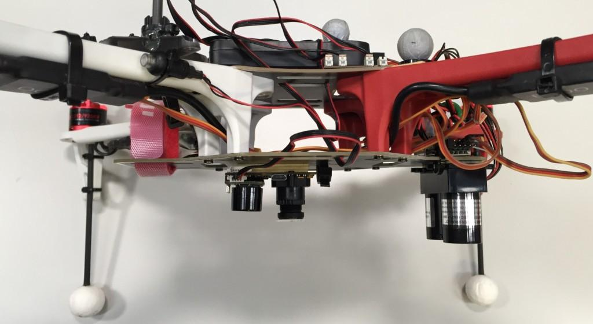
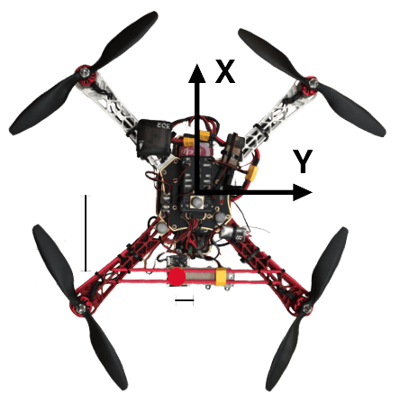

# Оптичний потік(Optical Flow)

_Optical Flow_ uses a downward facing camera and a downward facing distance sensor for velocity estimation.
It can be used to determine speed when navigating without GNSS — in buildings, underground, or in any other GNSS-denied environment.

The video below shows PX4 holding position using the [Ark Flow](../dronecan/ark_flow.md) sensor for velocity estimation in [Position Mode](../flight_modes_mc/position.md):

<lite-youtube videoid="aPQKgUof3Pc" title="ARK Flow with PX4 Optical Flow Position Hold"/>

<!-- ARK Flow with PX4 Optical Flow Position Hold: 20210605 -->

The image below shows an optical flow setup with a separate flow sensor ([PX4Flow](../sensor/px4flow.md)) and distance sensor ([Lidar-Lite](../sensor/lidar_lite.md)):



## Установка

An Optical Flow setup requires a downward facing camera and a downward facing [distance sensor](../sensor/rangefinders.md) (preferably a LiDAR).
These can be combined in a single product, such as the [ARK Flow](../dronecan/ark_flow.md), [ARK Flow MR](../dronecan/ark_flow_mr.md) and [Holybro H-Flow](https://holybro.com/products/h-flow), or they may be separate sensors.

The sensor(s) can be connected via MAVLink, I2C or any other bus that supports the peripheral.
Up to two optical flow sensors can be used at the same time (see [Multiple Optical Flow Sensors](#multiple-flow-sensors)).

:::info
If connected to PX4 via MAVLink the Optical Flow camera sensor must publish the [OPTICAL_FLOW_RAD](https://mavlink.io/en/messages/common.html#OPTICAL_FLOW_RAD) message, and the distance sensor must publish the [DISTANCE_SENSOR](https://mavlink.io/en/messages/common.html#DISTANCE_SENSOR) message.
The information is written to the corresponding uORB topics: [DistanceSensor](../msg_docs/DistanceSensor.md) and [ObstacleDistance](../msg_docs/ObstacleDistance.md).
:::

Вихід потоку при руху в різних напрямках повинен бути наступним:

| Рух транспортного засобу | Інтегрований потік |
| ------------------------ | ------------------ |
| Вперед                   | + Y                |
| Назад                    | - Y                |
| Справа                   | - X                |
| Зліва                    | + X                |

:::info
The integrated flow values are **angular measurements** (radians) representing rotation of the image about the sensor's body axes using the right-hand convention.
They are _not_ translational displacements along those axes, which is why forward vehicle movement (along X) appears in the Y flow axis, and rightward movement (along Y) appears in the X flow axis.
Specifically, forward movement causes the ground image to rotate about the Y axis (+ Y), while rightward movement causes a negative rotation about the X axis (- X).
:::

Дані сенсора від пристрою оптичного потоку об'єднуються з іншими джерелами даних швидкості.
The approach used for fusing sensor data and any offsets from the center of the vehicle must be configured in the [estimator](#estimators).

### Scale Factor

For pure rotations the `OPTICAL_FLOW_RAD.integrated_xgyro` and `OPTICAL_FLOW_RAD.integrated_x` (respectively `integrated_ygyro` and `integrated_y`) have to be the same.
If this is not the case, the optical flow scale factor can be adjusted using [SENS_FLOW0_SCALE](../advanced_config/parameter_reference.md#SENS_FLOW0_SCALE).

:::tip
The low resolution of common optical flow sensors can cause slow oscillations when hovering at a high altitude above ground (> 20m).
Reducing the optical flow scale factor can improve the situation.
:::

## Датчики потоку/Камери

### Agam FloRange

[Agam FloRange](../dronecan/agam_florange.md) is a [DroneCAN](../dronecan/index.md) optical flow sensor, [distance sensor](../sensor/rangefinders.md), and IMU.
It has a PixArt PAA3905 optical flow sensor, Broadcom AFBR-S50LV85D 30-metre distance sensor, and InvenSense ICM-42688-P 6-Axis IMU.

### ARK Flow & ARK Flow MR

[ARK Flow](../dronecan/ark_flow.md) is a [DroneCAN](../dronecan/index.md) optical flow sensor, [distance sensor](../sensor/rangefinders.md), and IMU.
It has a PAW3902 optical flow sensor, Broadcom AFBR-S50LV85D 30 meter distance sensor, and Invensense ICM-42688-P 6-Axis IMU.

[ARK Flow MR](../dronecan/ark_flow_mr.md) is a [DroneCAN](../dronecan/index.md) optical flow sensor, [distance sensor](../sensor/rangefinders.md), and IMU, for mid-range applications.
It has a PixArt PAA3905 optical flow sensor, Broadcom AFBR-S50LX85D 50 meter distance sensor, and Invensense IIM-42653 6-Axis IMU.

### Holybro H-Flow

The [Holybro H-Flow](https://holybro.com/products/h-flow) is a compact [DroneCAN](../dronecan/index.md) optical flow and [distance sensor](../sensor/rangefinders.md) module.
It combines a PixArt PAA3905 optical flow sensor, a Broadcom AFBR-S50LV85D distance sensor, and an InvenSense ICM-42688-P 6-axis IMU.
An all-in-one design that simplifies installation, with an onboard infrared LED enhances visibility in low-light conditions.

### Датчики на основі PMW3901

[PMW3901](../sensor/pmw3901.md) is an optical flow tracking sensor similar to what you would find in a computer mouse, but adapted to work between 80 mm and infinity.
It is used in a number of products, including some from: Bitcraze, Tindie, CubePilot, Thone and Alientek.

### Інші Камери/Сенсори

Також можна використовувати дошку/квадрокоптер, яка має вбудовану камеру.
For this the [Optical Flow repo](https://github.com/PX4/PX4-OpticalFlow) can be used (see also [snap_cam](https://github.com/PX4/snap_cam)).

## Далекомір

You can use any supported [distance sensor](../sensor/rangefinders.md).
Проте ми рекомендуємо використовувати LIDAR замість зондів сонар, через їхню надійність та точність.

## Оцінювач

Оцінювачі об'єднують дані з датчика оптичного потоку та інших джерел.
Налаштування для виконання злиття, а також відносні зсуви до центру транспортного засобу повинні бути вказані для використаного оцінювача.

Зміщення обчислюються відносно орієнтації транспортного засобу та центру, як показано нижче:



Optical Flow based navigation is enabled by both [EKF2](#ekf2) and LPE (deprecated).

### Extended Kalman Filter (EKF2) {#ekf2}

For optical flow fusion using EKF2, set [EKF2_OF0_CTRL](../advanced_config/parameter_reference.md#EKF2_OF0_CTRL).

Якщо ваш оптичний датчик потоку зміщений від центру транспортного засобу, ви можете встановити це за допомогою наступних параметрів.

| Parameter                                                                                                                                                                  | Опис                                                                                                                                  |
| -------------------------------------------------------------------------------------------------------------------------------------------------------------------------- | ------------------------------------------------------------------------------------------------------------------------------------- |
| <a id="SENS_FLOW0_POS_X"></a>[SENS_FLOW0_POS_X](../advanced_config/parameter_reference.md#SENS_FLOW0_POS_X) | Позиція X оптичного потоку фокусної точки в системі тіла (за замовчуванням 0.0 м). |
| <a id="SENS_FLOW0_POS_Y"></a>[SENS_FLOW0_POS_Y](../advanced_config/parameter_reference.md#SENS_FLOW0_POS_Y) | Позиція Y оптичного потоку фокусної точки в системі тіла (за замовчуванням 0.0 м). |
| <a id="SENS_FLOW0_POS_Z"></a>[SENS_FLOW0_POS_Z](../advanced_config/parameter_reference.md#SENS_FLOW0_POS_Z) | Позиція Z оптичного потоку фокусної точки в системі тіла (за замовчуванням 0.0 м). |

See [Using PX4's Navigation Filter (EKF2) > Optical flow](../advanced_config/tuning_the_ecl_ekf.md#optical-flow) for more information.

## Multiple Optical Flow Sensors {#multiple-flow-sensors}

<Badge type="tip" text="main (planned for PX4 v1.17)" />

PX4 supports up to two optical flow sensors at the same time.
A second sensor can add redundancy, or extend the usable envelope by combining sensors with different operating ranges.
Both sensors are fused, each at its own measurement rate.
A sensor that temporarily cannot be fused (for example when it leaves its operating range) keeps being processed for monitoring, and its data is used again as soon as it recovers.
A sensor whose measurements are rejected while the other sensor is still fused is considered faulty: it never resets the velocity or height above ground estimate, it is stopped and retried later.

Each sensor is bound to a parameter "slot" `n` (`0` or `1`) using its device ID:

- [SENS_FLOW0_ID](../advanced_config/parameter_reference.md#SENS_FLOW0_ID) and [SENS_FLOW1_ID](../advanced_config/parameter_reference.md#SENS_FLOW1_ID) record the device ID of the sensor bound to the `SENS_FLOWn_*` parameters.
  While an ID parameter is `0` (default), the first unbound sensor that delivers data is bound to it, and the assignment is saved so that it remains stable across reboots.
  The EKF uses the same slot numbering: `EKF2_OFn_*` parameters apply to the sensor bound to `SENS_FLOWn_ID`.
- Fusion is enabled per slot using [EKF2_OF0_CTRL](../advanced_config/parameter_reference.md#EKF2_OF0_CTRL) and [EKF2_OF1_CTRL](../advanced_config/parameter_reference.md#EKF2_OF1_CTRL).
  Only slot 0 is enabled by default.
  A slot can be enabled or disabled at runtime.
- When a sensor is replaced, the new sensor has a different device ID and is bound to the next free slot, which is not fused by default.
  To bind the new sensor to the old slot, set its `SENS_FLOWn_ID` parameter to `0` and reboot.
- All other optical flow parameters exist once per sensor: sensor properties such as delay, rotation, and mounting position in `SENS_FLOW0_*`/`SENS_FLOW1_*`, and fusion tuning such as noise and quality thresholds in `EKF2_OF0_*`/`EKF2_OF1_*`, so each sensor can be configured independently.

Note the following requirements and behaviour:

- All flow sensors must be mounted facing downwards.
  The sensors do not need to have the same yaw orientation (set individually using `SENS_FLOWn_ROT`), and each sensor has its own position offset (`SENS_FLOWn_POS_X` and so on).
- Flow sensors are not paired with specific [distance sensors](../sensor/rangefinders.md).
  The EKF estimates a single height above ground that is used for all flow sensors, corrected for each sensor's position offset.
  The minimum and maximum operating distance reported by each sensor is applied individually.
- A distance measurement provided by a flow sensor itself (as on the [ARK Flow](../dronecan/ark_flow.md)) can substitute for a missing distance sensor.
  Only the measurement from the first sensor that reports a distance is used for this purpose.
- The preflight check enabled by [SYS_HAS_NUM_OF](../advanced_config/parameter_reference.md#SYS_HAS_NUM_OF) passes when at least one sensor delivers valid data.

## Симуляція

Optical flow can be simulated with [SIH](../sim_sih/index.md), which computes the flow from the simulated vehicle motion instead of rendering a camera image.
As with real hardware, the simulated sensor reports the integrated flow only, so a downward facing [distance sensor](../sensor/rangefinders.md) has to be simulated alongside it — SIH provides one.

Two ready-made airframes have flow enabled and the estimator configured for it:

```sh
# Multicopter navigating on optical flow only (GNSS fusion disabled)
make px4_sitl_sih sihsim_quadx_flow

# Standard VTOL navigating on optical flow only (GNSS fusion disabled)
make px4_sitl_sih sihsim_standard_vtol_flow
```

The sensor itself is configured with the [`SIH_OF_*` parameters](../sim_sih/index.md#optical-flow) (rate, noise, and maximum ground distance).

Optical flow is also simulated by [Gazebo Classic](../sim_gazebo_classic/index.md), which renders the downward facing camera image and runs flow computation on it.
