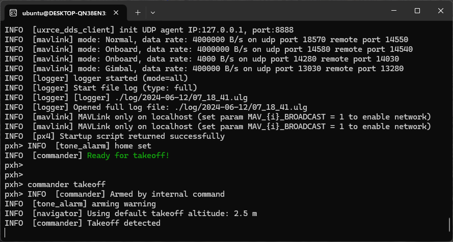
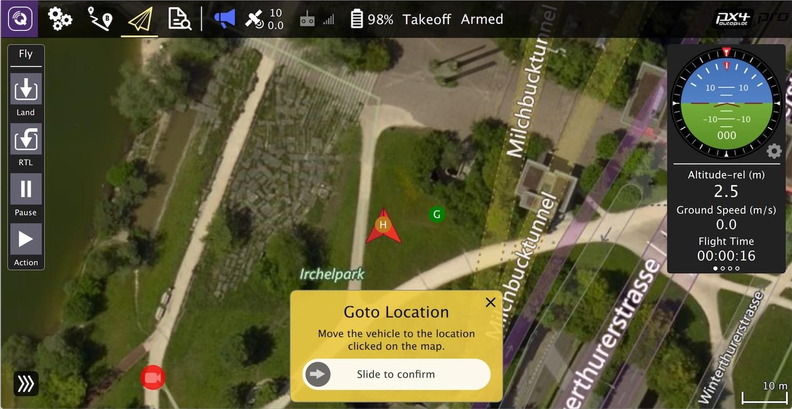
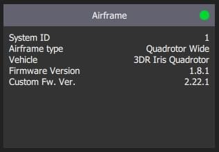

# 构建 PX4 软件

无论对于模拟器还是硬件目标设备，PX4固件可以在控制台或者IDE中从源码构建

若要使用[模拟器](../simulation/index.md)，或需要修改PX4并创建自定义构建，则必须自行构建PX4。如果您只想在实际硬件上试试 PX4，那么可以使用 QGroundControl[烧录预构建的二进制文件](../config/firmware.md)(无需跟着下面的指导)。

:::info
在跟着这些指导之前，你必须先为主机操作系统和目标硬件安装 [开发者工具链](../dev_setup/dev_env.md)。如果您在跟着这些步骤操作后有任何问题，请参阅下面的 [故障排除](#troubleshooting)。
:::

## 下载 PX4 源代码

PX4 源代码存储在 Github 上的 [PX4/PX4-Autopilot](https://github.com/PX4/PX4-Autopilot) 仓库中。

如果要在您的计算机上获得 _最新的_（main分支）版本，请在终端中输入以下命令：

```sh
git clone https://github.com/PX4/PX4-Autopilot.git --recursive
```

注意，您可能在[安装开发工具链](../dev_setup/dev_env.md)时已经完成了这项操作

:::info
你只需要执行它就能够得到最新的代码。如果需要，您也可以[获取特定版本的源代码](../contribute/git_examples.md#get-a-specific-release)。
[[GIT 示例](../contribute/git_examples.md) 提供了更多的信息，用于发布版本并对 PX4 作出贡献。
:::

## 初次构建（使用模拟器）

首先我们要用控制台环境来构建一个模拟器目标这使我们能够在转移到真正的硬件和 IDE 之前验证系统设置。

导航到 **PX4-Autopilot** 目录并使用以下命令启动 [Gazebo SITL](../sim_gazebo_gz/index.md)：

```sh
make px4_sitl gz_x500
```

这将显示 PX4 控制台：



:::info
您可能需要在继续之前启动 _QGroundControl_ ，因为默认的 PX4 配置需要在起飞前进行地面控制连接。可以[从这里下载](https://docs.qgroundcontrol.com/master/en/qgc-user-guide/getting_started/download_and_install.html)。
:::

可以通过键入以下命令（如上方控制台中所示）来控制飞行器。

```sh
pxh> commander takeoff
```

该载具将起飞，您将在 Gazebo simulator UI 中看到：


无人机可以通过输入 `Commander land` 来着陆，整个模拟可以通过 **CTRL+C** (或输入 `shutdown` )来停止。

与地面站一起飞模拟器更接近飞机的实际运行。在飞机飞行时（Takeoff飞行模式），单击地图上的某个位置并启用滑块。这将重新定位飞机。



## 基于NuttX / Pixhawk 的飞控板

### 为NuttX构建

若要构建基于NuttX-或 Pixhawk的飞控板，请导航到 **PX4-Autopilot** 目录，然后调用 `make` ，并为您的板调用构建目标。

例如，要为 [Pixhawk 4](../flight_controller/pixhawk4.md) 硬件构建，可使用以下命令：

```sh
cd PX4-Autopilot
make px4_fmu-v5_default
```

:::tip
您也可以使用 [px4-dev Docker 容器](../test_and_ci/docker.md) 进行构建，而无需在本地安装工具链。来自 PX4-Autopilot 目录：

```sh
./Tools/docker_run.sh 'make px4_fmu-v5_default'
```

:::

运行成功后将输出类似结果：

```sh
-- Build files have been written to: /home/youruser/src/PX4-Autopilot/build/px4_fmu-v4_default
[954/954] Creating /home/youruser/src/PX4-Autopilot/build/px4_fmu-v4_default/px4_fmu-v4_default.px4
```

构建目标 `px4_fmu-v4` 的第一部分表示目标飞行控制器固件的硬件。后缀（此处为`_default`）表示固件的_配置_，例如支持或省略特定功能。

:::info
`_default` 后缀是可选的。例如，`make px4_fmu-v5` 和 `px4_fmu-v5_default` 都会生成相同的固件。
:::

以下列表显示了[Pixhawk标准](../flight_controller/autopilot_pixhawk_standard.md)飞行控制板的构建命令：

- [Holybro Pixhawk 6X-RT (FMUv6X)](../flight_controller/pixhawk6x-rt.md): `make px4_fmu-v6xrt_default`

- [Holybro Pixhawk 6X (FMUv6X)](../flight_controller/pixhawk6x.md): `make px4_fmu-v6x_default`

- [Holybro Pixhawk 6C (FMUv6C)](../flight_controller/pixhawk6c.md): `make px4_fmu-v6c_default`

- [Holybro Pixhawk 6C Mini (FMUv6C)](../flight_controller/pixhawk6c_mini.md): `make px4_fmu-v6c_default`

- [Holybro Pix32 v6 (FMUv6C)](../flight_controller/holybro_pix32_v6.md): `make px4_fmu-v6c_default`

- [Holybro Pixhawk 5X (FMUv5X)](../flight_controller/pixhawk5x.md): `make px4_fmu-v5x_default`

- [Pixhawk 4 (FMUv5)](../flight_controller/pixhawk4.md): `make px4_fmu-v5_default`

- [Pixhawk 4 Mini (FMUv5)](../flight_controller/pixhawk4_mini.md): `make px4_fmu-v5_default`

- [CUAV V5+ (FMUv5)](../flight_controller/cuav_v5_plus.md): `make px4_fmu-v5_default` - 已停产

- [CUAV V5 nano (FMUv5)](../flight_controller/cuav_v5_nano.md): `make px4_fmu-v5_default` - 已停产

- [Pixracer (FMUv4)](../flight_controller/pixracer.md): `make px4_fmu-v4_default`

- [Pixhawk 3 Pro](../flight_controller/pixhawk3_pro.md): `make px4_fmu-v4pro_default`

- [Pixhawk Mini](../flight_controller/pixhawk_mini.md): `make px4_fmu-v3_default`

- [Pixhawk 2 (Cube Black) (FMUv3)](../flight_controller/pixhawk-2.md): `make px4_fmu-v3_default`

- [mRo Pixhawk (FMUv3)](../flight_controller/mro_pixhawk.md): `make px4_fmu-v3_default` (支持 2MB Flash)

- [Holybro pix32 (FMUv2)](../flight_controller/autopilot_discontinued.md): `make px4_fmu-v2_default`  - 已停产

- [Pixfalcon (FMUv2)](../flight_controller/autopilot_discontinued.md): `make px4_fmu-v2_default`  - 已停产

- [Dropix (FMUv2)](../flight_controller/autopilot_discontinued.md): `make px4_fmu-v2_default`  - 已停产

- [Pixhawk 1 (FMUv2)](../flight_controller/autopilot_discontinued.md): `make px4_fmu-v2_default` - 已停产

  :::警告
  您**必须**使用受支持的 GCC 版本来构建此开发板（例如，当前 Ubuntu LTS 中的 `gcc-arm-none-eabi` 软件包，这与 CI 所使用的工具链相同），或者从构建中移除某些模块。使用不受支持的GCC进行构建可能会失败，因为PX4接近板载1MB闪存的容量限制。

:::

- 具有 2 MB flash 的 Pixhawk 1: `make px4_fmu-v3_default`

非 Pixhawk NuttX 飞控的构建命令（以及所有其他主板的命令）均在各款[飞控主板](../flight_controller/index.md)的文档中提供。

### 将固件烧录到飞控板

在 make 命令后添加 `upload`，通过USB将编译后的二进制文件上传至 autopilot 硬件。例如

```sh
make px4_fmu-v4_default upload
```

运行成功后将有以下输出：

```sh
Erase  : [====================] 100.0%
Program: [====================] 100.0%
Verify : [====================] 100.0%
Rebooting.

[100%] Built target upload
```

:::tip
在 WSL2 上开发时不支持此操作。参见[ Windows 开发环境 (WSL2-基于) > 烧录主板](../dev_setup/dev_env_windows_wsl.md#flash-a-flight-control-board)。
:::

## 其他飞控板

其他主板的构建命令详见[各主板专属飞行控制器页面](../flight_controller/index.md)（通常位于_构建固件_标题下）。

您还可以使用以下命令列出所有配置目标：

```sh
make list_config_targets
```

## 子模块

PX4 将多个库（如 NuttX、MAVLink 等）作为 Git 子模块引入。每次构建在配置时都会检查它们一次：

| 子模块状态                              | 本地编译      | CI (`CI=true`) |
| ---------------------------------- | --------- | --------------------------------- |
| 在提交时，PX4 会记录                       | Builds    | Builds                            |
| 缺失                                 | 获取，然后编译版本 | 获取，然后编译版本                         |
| 在另一个提交 (例如你改变它) | 警告，将其构建为  | 失败                                |

处于其他提交版本的子模块绝不会被重置，因此您可以直接对子模块（例如 NuttX 升级）的更改进行开发和测试。每次构建时系统都会对此发出警告，而您有责任将其保持在您期望的状态。要查看 PX4 记录的提交（例如在切换分支后），请运行：

```sh
git submodule sync --recursive && git submodule update --init --recursive
```

将 CMake 变量 `PX4_GIT_SUBMODULES` 设置为子模块路径的列表，以便仅检查这些路径，例如当另一个项目构建 PX4 且仅使用其中部分库时。如果构建中使用了尚未检出的子模块，则配置步骤将停止。设置 `GIT_SUBMODULES_ARE_EVIL=1`，即可完全跳过该检查，并自行管理子模块。

## 用图形界面 IDE 编译

[VSCode](../dev_setup/vscode.md是官方支持 (且推荐) 的  用于 PX4 开发的 IDE。它很容易设置，可以用于编译模拟和硬件环境的 PX4。

## 故障处理

### 常规构建错误

许多构建问题是由不匹配的子模块或未完全清理的构建环境引起的。更新子模块并进行 `distclean` 可以修复这些类型的错误：

```sh
git submodule update --recursive
make distclean
```

### 闪存溢出了 XXX 字节

`region 'flash' overflowed by XXXX bytes` 错误表明固件对目标硬件平台太大了。这对于`make px4_fmu-v2_default` 构建是常见的，它的 flash 大小被限制在 1MB。

如果您正在构建_vanilla_master 分支，最可能的原因是使用不支持的 GCC版本。在这种情况下，安装当前的 Ubuntu LTS 的 `gcc-arm-none-eabi` 包，正如[开发者工具链] (../dev_setup/dev_env.md) 说明的那样。

如果在构建自己的分支，您可能已将固件大小增加到超过1MB的限制。在这种情况下，您需要从构建中删除您不需要的任何驱动程序/模块。

### macOS：打开文件过多错误

MacOS 默认允许在所有正在运行的进程中最多打开256个文件。
PX4构建系统打开大量文件，因此您可能会超出此数量。

构建工具链为很多文件报 `Too many open files`，如下所示：

```sh
arm-none-eabi-ld: cannot find NuttX/nuttx/fs/libfs.a: Too many open files
```

解决方案是增加打开文件的最大允许数量(到 2048, 匹配[macOS 安装指令](../dev_setup/dev_env_mac.md#prerequisites))。您可以在每个会话的 macOS _终端_ 中这样做：

- 源于此脚本 [Tools/mac_set_ulimit.sh](https://github.com/PX4/PX4-Autopilot/blob/main/Tools/mac_set_ulimit.sh) (它必须来源，不执行才能影响您当前的 shell):

  ```sh
  source Tools/mac_set_ulimit.sh
  ```

- 或者直接输入命令：

  ```sh
  ulimit -S -n 2048
  ```

若要将它应用到每个新终端，请将 `ulimit` 行添加到`~/zshrc` 中，如macOS setup中所述。

### macOS Catalina：运行cmake时出现问题

对于 macOS Catalina 10.15.1 ，在尝试使用 _cmake _ 构建模拟器时可能会遇到问题。如果您在这个平台上遇到构建问题，请尝试在终端中运行以下命令：

```sh
xcode-select --install
sudo ln -s /Library/Developer/CommandLineTools/SDKs/MacOSX.sdk/usr/include/* /usr/local/include/
```

### 导入Python软件包失败

运行 `make px4_sitl gz_x500` 命令时出现“导入失败”错误，表明某些 Python 包未安装（或未安装在预期位置）。

```sh
Failed to import jinja2: No module named 'jinja2'
您可能需要使用以下方式进行安装:
    pip3 install --user jinja2
```

如果您已经安装了这些依赖项，这可能是因为计算机上安装了多个 Python 版本（例如 Python 2.7.16 和 Python 3.8.3），而构建工具链所使用的版本中并不包含该模块。

你可以通过安装仓库中 requirements 文件所列的依赖项来解决这个问题：

```sh
pip3 install --user -r Tools/setup/requirements.txt
```

## PX4 创建生成目标

前面的章节显示了您如何调用 _make_ 来构建一些不同的目标，启动模拟器，使用 IDE 等。
This section shows how _make_ options are constructed and how to find the available choices.

使用特定配置和初始化文件调用 _make_ 的完整语法是：

```sh
make [VENDOR_][MODEL][_VARIANT] [VIEWER_MODEL_DEBUGGER_WORLD]
```

**VENDOR_MODEL_VARIANT**: (也称为`CONFIGURATION_TARGET`)

- \*\*VENDOR：\*\*主板制造商：`px4`、`aerotenna`、`airmind`、`atlflight`、`auav`、`beaglebone`、`intel`、`nxp` 等。
  Pixhawk 系列主板的供应商名称为 `px4`。
- \*\*MODEL：\*\*飞控板型号 “model”：`sitl`、`fmu-v2`、`fmu-v3`、`fmu-v4`、`fmu-v5`、`navio2` 等。
- **VARIANT：** 表示特定的配置：例如 `bootloader`、`cyphal`、`sih`，这些配置会在 `default` 配置的基础上添加或移除组件。最常见的情况是 `default`, 并且可能被省略。

:::tip
您可以使用下面的命令获取一个可用的`CONFIGURATION_TARGET`选项列表：

```sh
make list_config_targets
```

:::

**VIEWER_MODEL_DEBUGER_WORLD:**

- **VIEWER：** 这是用于启动和连接的模拟器（“查看器”）：`gz`、`gazebo`、`none` <!-- 、?airsim -->

  :::tip
  如果要启动 PX4 并等待模拟器（Gazebo、Gazebo Classic 或其他模拟器）就绪，可以使用 `none`。例如，`make px4_sitl none_iris` 在没有模拟器的情况下启动 PX4 (但使用 iris 机架)。

:::

- MODEL:要使用的 载具 模型（例如 iris (default)、rover、tailsitter 等），该模型将由模拟器加载。环境变量 `PX4_SIM_MODEL` 将被设置为选中的模型，然后在[启动脚本](../simulation/index.md#startup-scripts)中使用以选择适当的参数。

- **DEBUGER:** 调试器使用: `none` (_default_), `ide`, `gdb`, `lldb`, `ddd`, `valgrind`, `callgrind`.
  更多信息请参阅[模拟调试](../debug/simulation_debugging.md)。

- **WORLD**: (仅限Gazebo Classic).
  设置加载的世界（[PX4-Autopilot/Tools/simulation/gazebo-classic/sitl_gazebo-classic/worlds](https://github.com/PX4/PX4-SITL_gazebo-classic/tree/main/worlds)）。默认为 [empty.world](https://github.com/PX4/PX4-SITL_gazebo-classic/blob/main/worlds/empty.world)。欲了解更多信息，请参阅[Gazebo Classic > 加载特定世界](../sim_gazebo_classic/index.md#loading-a-specific-world)。

::: info

- `CONFIGURATION_TARGET`和`VIEWER_MODEBUGER`中的大多数值都有默认值，因此是可选的。例如，`gazebo-classic`等于`gazebo-classic_iris`或`gazebo-classic_iris_none`。
- 如果要在其他两个设置之间指定默认值，可以使用三个下划线。例如，`gazebo-classic___gdb`相当于`gazebo-classic_iris_gdb`。
- 你可以使用 "none" 值为 "VIEWER_MODEBUGER" 来启动 PX4 并等待模拟器。例如，使用 `make px4_sitl_default none` 启动 PX4，然后启动模拟器。

:::

`VENDOR_MODEL_VARIANT`选项映射为 [/boards](https://github.com/PX4/PX4-Autopilot/tree/main/boards) 目录下的 PX4 源树中的特殊_px4board_ 配置文件。具体而言，`VENDOR_MODEL_VARIANT` 映射到配置文件 **boards/VENDOR/MODEL/VARIANT.px4board**
（例如 `px4_fmu-v5_default` 对应 [boards/px4/fmu-v5/default.px4board](https://github.com/PX4/PX4-Autopilot/blob/main/boards/px4/fmu-v5/default.px4board)）。

其他 make 目标在相关章节中讨论：

- `bloaty_compare_master`：[二进制大小分析](../debug/binary_size_profiling.md)
- ...

## 固件版本和 Git 标签

_PX4固件版本_和_自定义固件版本_通过 MAVLink [AUTOPILOT_VERSION](https://mavlink.io/en/messages/common.html#AUTOPILOT_VERSION)消息发布，并在_QGroundControl_的**设置 > 摘要**机身面板中显示：



这些是在构建时从您仓库树的活动_gi tag_中提取的。
git 标签应该格式化为 `<PX4-version>-<vendor-version>` (例如上面图像中的标签被设置为 `v1.8.1-2.22.1`)。

:::warning
如果您使用不同的 git 标签格式，可能无法正确显示版本信息。
:::
