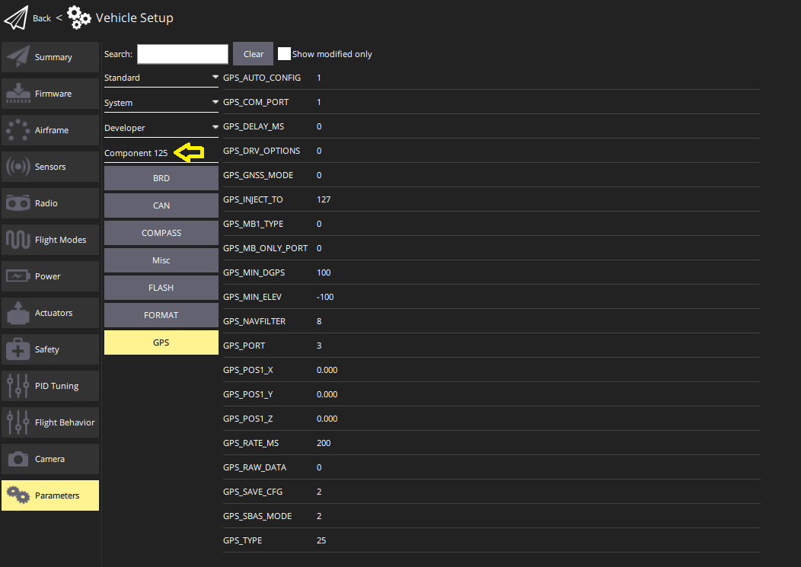

# DroneCAN

[DroneCAN](https://dronecan.github.io/) 是一种开放的软件通信协议，用于载具上的飞行控制器与其他 [CAN](../can/index.md) 设备之间的相互通信。

:::warning

- 默认情况下，DroneCAN 及使用它的特定传感器和功能均未启用。有关设置的信息，请参阅 [PX4 配置](#px4-configuration)。
- PX4 需要使用 SD 卡来启用动态节点分配和进行[固件更新](#firmware-update)。飞行过程中不会使用该 SD 卡。

:::

:::info
DroneCAN 以前称为 UAVCAN v0（或简称 UAVCAN）。该名称于 2022 年更改。
:::

## DroneCAN 的优势

通过 DroneCAN 连接外设具有诸多优势：

- 已支持多种不同的传感器和执行器。
- CAN 专为在较长距离上提供稳健、可靠的连接而设计。它支持在较大的机体上安全使用电调，并提供通信冗余。
- 该总线支持双向通信，可用于健康监测、诊断和转速数传。
- 布线更简单，因为可以使用一条总线连接所有电调和其他 DroneCAN 外设。
- 设置更简单，因为可以通过手动转动各个电机来配置电调编号。
- 用户可通过 PX4 集中配置所有连接到 CAN 总线的设备并更新其固件。
- PX4 会自动跟踪设备信息（厂商、型号、版本、序列号），用于维护和机队管理。参见[资产跟踪](../debug/asset_tracking.md)。

## 支持的硬件

支持符合 DroneCAN/UAVCAN v0 标准的大多数常见类型外设（传感器、电调和舵机）。

支持的硬件包括（此列表并不完整）：

- [电调/电机控制器](../dronecan/escs.md)

- 空速传感器
  - [Holybro 高精度 DroneCAN 空速传感器 - DLVR](https://holybro.com/collections/sensors/products/high-precision-dronecan-airspeed-sensor-dlvr)
  - [RaccoonLab 空速传感器](https://docs.raccoonlab.co/guide/airspeed/)
  - [Thiemar 空速传感器](https://github.com/thiemar/airspeed)

- 用于 GNSS（GPS、GLONASS、北斗等）的 GNSS 接收机
  - [ARK GPS](../dronecan/ark_gps.md)
  - [ARK RTK GPS](../dronecan/ark_rtk_gps.md)
  - [CubePilot Here3](https://www.cubepilot.org/#/here/here3)
  - [CUAV NEO v2 Pro GNSS](https://doc.cuav.net/gps/neo-series-gnss/en/neo-v2-pro.html)
  - [CUAV NEO 3 Pro GPS](../gps_compass/gps_cuav_neo_3pro.md)
  - [CUAV NEO 3X GPS](../gps_compass/gps_cuav_neo_3x.md)
  - [CUAV C-RTK2 PPK/RTK GNSS](../gps_compass/rtk_gps_cuav_c-rtk2.md)
  - [Holybro H-RTK ZED-F9P（DroneCAN 版本）](../dronecan/holybro_h_rtk_zed_f9p_gps.md)
  - [Holybro DroneCAN M8N GPS](../dronecan/holybro_m8n_gps.md)
  - [Holybro DroneCAN M9N GPS](https://holybro.com/products/dronecan-m9n-gps)
  - [Holybro DroneCAN H-RTK F9P Rover](https://holybro.com/products/dronecan-h-rtk-f9p-rover)
  - [Holybro DroneCAN H-RTK F9P Helical](https://holybro.com/products/dronecan-h-rtk-f9p-helical)
  - [RaccoonLab GNSS 模块](https://docs.raccoonlab.co/guide/gps_mag_baro/)
  - [Zubax GNSS](https://shop.zubax.com/products/zubax-gnss-2)

- 电源监测器
  - [Pomegranate Systems Power Module](../dronecan/pomegranate_systems_pm.md)
  - [CUAV CAN PMU 电源模块](../dronecan/cuav_can_pmu.md)
  - [RaccoonLab CAN 电源连接器和管理单元](../dronecan/raccoonlab_power.md)

- 罗盘
  - [Holybro RM3100 专业级罗盘](https://holybro.com/products/dronecan-rm3100-compass)
  - [RaccoonLab RM3100 磁力计](https://docs.raccoonlab.co/guide/gps_mag_baro/mag_rm3100.html)

- 距离传感器
  - [ARK Dist](ark_dist.md)
  - [Ark Dist MR](ark_dist_mr.md)
  - [Avionics Anonymous 激光高度计 UAVCAN 接口](../dronecan/avanon_laser_interface.md)
  - [RaccoonLab uRangefidner 和测距仪适配器](https://docs.raccoonlab.co/guide/rangefinder/)
  - [Smartmicro 无人机高度计](smartmicro_t132.md)

- Grippers
  - [DroneCAN 电永磁铁（EPM）](../peripherals/gripper_epm.md)

- 光流
  - [Agam FloRange](agam_florange.md)
  - [Ark Flow](ark_flow.md)
  - [Ark Flow MR](ark_flow_mr.md)

- 通用 CAN 节点（可在 CAN 总线上使用 I2C、SPI、UART 传感器）。
  - [ARK CANnode](../dronecan/ark_cannode.md)
  - [RaccoonLab 节点](../dronecan/raccoonlab_nodes.md)

## 硬件安装

DroneCAN 运行在 CAN 网络上。
DroneCAN 硬件应按照 [CAN > 接线](../can/index.md#wiring)中的说明连接。

## 节点 ID 分配

每个 DroneCAN 设备都必须配置一个在机体上唯一的 _节点 ID_。

大多数设备支持 _动态节点分配（DNA）_，使 PX4 能够在系统启动时自动配置每个检测到的外设的节点 ID。有关设备是否支持 DNA 及如何启用的详细信息，请查阅制造商文档。许多设备在节点 ID 设为 0 时会自动切换为 DNA。当 [UAVCAN_ENABLE](../advanced_config/parameter_reference.md#UAVCAN_ENABLE) 参数 > 1（设为 2 或 3）时，PX4 将启用内置分配服务器。

某些设备不支持 DNA。此外，在某些关键任务场景中，您可能更倾向于提前手动配置节点 ID，而不是依赖动态分配服务器。要完全禁用 DNA，请将 `UAVCAN_ENABLE` 设为 `1`，并手动为每个节点 ID 设置唯一值。如果 DNA 仍在运行，而某些设备需要手动配置，请为这些设备设置大于 DroneCAN 设备总数的节点 ID，以避免冲突。

:::info
PX4 的节点 ID 可以通过 [UAVCAN_NODE_ID](../advanced_config/parameter_reference.md#UAVCAN_NODE_ID) 参数配置。该参数默认设为 1。

运行 [PX4 DroneCAN 固件](px4_cannode_fw.md)的设备（例如 [ARK CANnode](ark_cannode.md)）可以使用
[CANNODE_NODE_ID](../advanced_config/parameter_reference.md#CANNODE_NODE_ID) 参数设置静态节点 ID。将其设为 0（默认值）可使用动态分配，或设为 1-125 之间的值以使用指定的静态节点 ID。
:::

:::warning
截至本文撰写时，PX4 不会在 CAN2 端口上运行节点分配服务器。这意味着，如果设备 _仅_ 连接到 CAN2（未以冗余方式同时连接 CAN1 和 CAN2），就需要手动配置其节点 ID。
:::

## PX4 配置

通过在 QGroundControl 中[设置特定 PX4 参数](../advanced_config/parameters.md)，可以在 PX4 上配置 DroneCAN。您需要启用 DroneCAN 本身，以及所用功能对应的消息订阅和发布。

:::info
在某些情况下，还需要配置已连接 CAN 设备上的参数（这些参数也可以[通过 QGC 设置](#qgc-cannode-parameter-configuration)）。
:::

### 启用 DroneCAN

要启用 PX4 DroneCAN 驱动，请设置 [UAVCAN_ENABLE](../advanced_config/parameter_reference.md#UAVCAN_ENABLE) 参数：

- `0`：禁用 DroneCAN 驱动
- `1`：启用面向传感器的 DroneCAN 驱动，禁用 [DNA 服务器](#node-id-allocation)
- `2`：启用面向传感器的 DroneCAN 驱动，启用 DNA 服务器
- `3`：启用面向传感器和电调的 DroneCAN 驱动，启用 DNA 服务器

如果支持 DNA，建议设为 `2` 或 `3`。

### DroneCAN 消息订阅与发布

为避免大量消息占用 CAN 总线，PX4 默认不会发布或订阅那些 _可能_ 需要的 DroneCAN 消息。您必须通过设置相应的 [UAVCAN 参数](../advanced_config/parameter_reference.md#uavcan)，启用特定功能所需消息的发布或订阅。

:::info
只有启用相应的 DroneCAN [传感器订阅](#sensors)后，相关传感器参数才可能存在（在 QGC 中可见）！

例如，只有启用 [UAVCAN_SUB_FLOW](../advanced_config/parameter_reference.md#UAVCAN_SUB_FLOW) 后，[SENS_FLOW_MINHGT](../advanced_config/parameter_reference.md#SENS_FLOW_MINHGT) 参数才会出现。
:::

例如，要使用已连接的 DroneCAN 智能电池，需要启用 [UAVCAN_SUB_BAT](../advanced_config/parameter_reference.md#UAVCAN_SUB_BAT) 参数，使 PX4 订阅并接收 [BatteryInfo](https://dronecan.github.io/Specification/7._List_of_standard_data_types/#batteryinfo) DroneCAN 消息。如果使用的外设需要知道 PX4 是否已解锁，则需要设置 [UAVCAN_PUB_ARM](../advanced_config/parameter_reference.md#UAVCAN_PUB_ARM) 参数，使 PX4 开始发布 [ArmingStatus](https://dronecan.github.io/Specification/7._List_of_standard_data_types/#armingstatus) 消息。当 [UAVCAN_ENABLE](../advanced_config/parameter_reference.md#UAVCAN_ENABLE) 为 `3`（电调输出）时，会自动发布 ArmingStatus。

参数名称以 `UAVCAN_SUB_` 或 `UAVCAN_PUB_` 为前缀，分别表示启用 PX4 的订阅或发布。名称的其余部分表示要设置的具体消息或功能。

连接到 PX4 的 DroneCAN 外设也可以[通过 QGC 设置参数进行配置](#qgc-cannode-parameter-configuration)。按照约定，以 [CANNODE_](../advanced_config/parameter_reference.md#CANNODE_BITRATE) 为前缀的参数具有预定义的含义，并可能在参数参考中有相应说明。以 `CANNODE_PUB_` 和 `CANNODE_SUB_` 为前缀的 `CANNODE_` 参数可分别启用外设对相应 DroneCAN 消息的发布和订阅。这些参数可将 DroneCAN 外设配置为仅订阅和发布实际需要的消息（与 PX4 使用相应的 `UAVCAN_PUB_`/`UAVCAN_SUB_` 参数的方式相同）。请注意，外设可能不使用 `CANNODE_` 参数，在这种情况下，无论是否需要，外设都可能必须发布或订阅特定消息。

以下各节进一步介绍用于启用特定功能的 PX4 和 DroneCAN 外设参数。

#### 传感器

可启用的 DroneCAN 传感器参数及订阅如下（自 PX4 v1.14 起）：

- [UAVCAN_SUB_ASPD](../advanced_config/parameter_reference.md#UAVCAN_SUB_ASPD)：空速计
- [UAVCAN_SUB_BARO](../advanced_config/parameter_reference.md#UAVCAN_SUB_BARO)：气压计
- [UAVCAN_SUB_BAT](../advanced_config/parameter_reference.md#UAVCAN_SUB_BAT)：电池监测器/电源模块
- [UAVCAN_SUB_BTN](../advanced_config/parameter_reference.md#UAVCAN_SUB_BTN)：按钮
- [UAVCAN_SUB_DPRES](../advanced_config/parameter_reference.md#UAVCAN_SUB_DPRES)：差分气压计
- [UAVCAN_SUB_FLOW](../advanced_config/parameter_reference.md#UAVCAN_SUB_FLOW)：光流计
- [UAVCAN_SUB_GPS](../advanced_config/parameter_reference.md#UAVCAN_SUB_GPS)：GPS
- [UAVCAN_SUB_GPS_R](../advanced_config/parameter_reference.md#UAVCAN_SUB_GPS_R)<Badge type="tip" text="PX4 v1.15" />：订阅 GNSS 相对位置消息（[RelPosHeading](https://dronecan.github.io/Specification/7._List_of_standard_data_types/#relposheading)）。在 PX4 v1.15 中仅用于日志记录。
- [UAVCAN_SUB_HYGRO](../advanced_config/parameter_reference.md#UAVCAN_SUB_HYGRO)：湿度计
- [UAVCAN_SUB_ICE](../advanced_config/parameter_reference.md#UAVCAN_SUB_ICE)：内燃机（ICE）。
- [UAVCAN_SUB_IMU](../advanced_config/parameter_reference.md#UAVCAN_SUB_IMU)：IMU
- [UAVCAN_SUB_MAG](../advanced_config/parameter_reference.md#UAVCAN_SUB_MAG)：磁力计（罗盘）
- [UAVCAN_SUB_RNG](../advanced_config/parameter_reference.md#UAVCAN_SUB_RNG)：测距仪（距离传感器）。

#### GPS

PX4 DroneCAN 参数：

- 启用 [UAVCAN_SUB_GPS](../advanced_config/parameter_reference.md#UAVCAN_SUB_GPS)。
- 如果 GPS 模块内置罗盘，请启用 [UAVCAN_SUB_MAG](../advanced_config/parameter_reference.md#UAVCAN_SUB_MAG)。

GPS CANNODE 参数（[通过 QGC 设置](#qgc-cannode-parameter-configuration)）：

- 将 CAN 总线上最后一个节点的 [CANNODE_TERM](../advanced_config/parameter_reference.md#CANNODE_TERM) 设为 `1`。

其他 PX4 参数：

- 如果 GPS 未安装在机体重心处，可以使用 [SENS_GNSS0_OFFX](../advanced_config/parameter_reference.md#SENS_GNSS0_OFFX)、[SENS_GNSS0_OFFY](../advanced_config/parameter_reference.md#SENS_GNSS0_OFFY) 和 [SENS_GNSS0_OFFZ](../advanced_config/parameter_reference.md#SENS_GNSS0_OFFZ) 补偿偏移。
- 如果 GPS 模块提供偏航信息，可以将 [EKF2_GPS_CTRL](../advanced_config/parameter_reference.md#EKF2_GPS_CTRL) 的第 3 位设为 true，以启用 GPS 偏航融合。

#### RTK GPS

设置与上文 [GPS](#gps) 相同的参数。此外，根据 RTK 配置采用流动站与固定基站、流动站与移动基站，或同时采用两种方式，您可能还需要设置以下参数。

##### 流动站与固定基站

利用来自 RTK 基站模块的 RTCM 消息确定流动站的位置（基站模块连接到 QGC，由 QGC 通过 MAVLink 将 RTCM 信息发送给 PX4）。

PX4 DroneCAN 参数：

- [UAVCAN_PUB_RTCM](../advanced_config/parameter_reference.md#UAVCAN_PUB_RTCM)：
  - 使 PX4 向总线发布 RTCM 消息（[RTCMStream](https://dronecan.github.io/Specification/7._List_of_standard_data_types/#rtcmstream)）（这些消息由 PX4 通过 QGC 从 RTK 基站模块获取）。

流动站模块参数（同样[通过 QGC 设置](#qgc-cannode-parameter-configuration)）：

- [CANNODE_SUB_RTCM](../advanced_config/parameter_reference.md#CANNODE_SUB_RTCM) 指示流动站订阅总线上的 [RTCMStream](https://dronecan.github.io/Specification/7._List_of_standard_data_types/#rtcmstream) RTCM 消息（来自移动基站）。

:::info
也可以改用 [UAVCAN_PUB_MBD](../advanced_config/parameter_reference.md#UAVCAN_PUB_MBD) 和 [CANNODE_SUB_MBD](../advanced_config/parameter_reference.md#CANNODE_SUB_MBD)，它们也用于发布 RTCM 消息（这些参数较新）。使用 [RTCMStream](https://dronecan.github.io/Specification/7._List_of_standard_data_types/#rtcmstream) 消息意味着可以同时实现移动基站功能（见下文）。
:::

##### 流动站与移动基站

如[使用双 u-blox F9P 实现 RTK GPS 航向测量](../gps_compass/u-blox_f9p_heading.md)中所述，机体可以安装两个 RTK 模块，以根据 GPS 计算偏航角。在此配置中，机体配备一个 _移动基站_ RTK GPS 和一个 _流动站_ RTK GPS。

可以分别在[移动基站和流动站 RTK CAN 节点上设置](#qgc-cannode-parameter-configuration)以下参数：

- [CANNODE_PUB_MBD](../advanced_config/parameter_reference.md#CANNODE_PUB_MBD) 使移动基站 GPS 单元向总线发布 [MovingBaselineData](https://dronecan.github.io/Specification/7._List_of_standard_data_types/#movingbaselinedata) RTCM 消息（供流动站使用）
- [CANNODE_SUB_MBD](../advanced_config/parameter_reference.md#CANNODE_SUB_MBD) 指示流动站订阅总线上的 [MovingBaselineData](https://dronecan.github.io/Specification/7._List_of_standard_data_types/#movingbaselinedata) RTCM 消息（来自移动基站）。

在自动驾驶仪上，将流动站对应槽位（由 [SENS_GNSSn_ID](../advanced_config/parameter_reference.md#SENS_GNSS0_ID) 匹配）的 [SENS_GNSSn_HDG](../advanced_config/parameter_reference.md#SENS_GNSS0_HDG) 设为 `Moving base rover`，并设置两个节点的天线偏移量（参见[航向基线](../gps_compass/rtk_gps.md#configuring-gps-as-yaw-heading-source)）。运行旧版固件的节点会减去自身的 `GPS_YAW_OFFSET`；请将该参数保持为 0。

#### Barometer

PX4 DroneCAN 参数：

- 启用 [UAVCAN_SUB_BARO](../advanced_config/parameter_reference.md#UAVCAN_SUB_BARO)。

#### 罗盘

PX4 DroneCAN 参数：

- 启用 [UAVCAN_SUB_MAG](../advanced_config/parameter_reference.md#UAVCAN_SUB_MAG)。

#### 距离传感器/测距仪

PX4 DroneCAN 参数：

- 启用 [UAVCAN_SUB_RNG](../advanced_config/parameter_reference.md#UAVCAN_SUB_RNG)。
- 设置 [UAVCAN_RNG_MIN](../advanced_config/parameter_reference.md#UAVCAN_RNG_MIN) 和 [UAVCAN_RNG_MAX](../advanced_config/parameter_reference.md#UAVCAN_RNG_MAX)，即距离传感器的最小和最大量程。

其他 PX4 参数：

- 如果测距仪未安装在机体重心处，可以使用 [EKF2_RNG_POS_X](../advanced_config/parameter_reference.md#EKF2_RNG_POS_X)、[EKF2_RNG_POS_Y](../advanced_config/parameter_reference.md#EKF2_RNG_POS_Y) 和 [EKF2_RNG_POS_Z](../advanced_config/parameter_reference.md#EKF2_RNG_POS_Z) 补偿偏移。
- 其他 `EKF2_RNG_*` 参数也可能适用，如有需要，应在相应测距仪的文档中说明。

#### Optical Flow Sensor

PX4 DroneCAN 参数：

- 启用 [UAVCAN_SUB_FLOW](../advanced_config/parameter_reference.md#UAVCAN_SUB_FLOW)。

其他 PX4 参数：

- 设置 [SENS_FLOW_MINHGT](../advanced_config/parameter_reference.md#SENS_FLOW_MINHGT) 和 [SENS_FLOW_MAXHGT](../advanced_config/parameter_reference.md#SENS_FLOW_MAXHGT)，即光流传感器的最小和最大工作高度。
- 设置 [SENS_FLOW_MAXR](../advanced_config/parameter_reference.md#SENS_FLOW_MAXR)，即传感器的最大光流角速率。
- 通过设置 [EKF2_OF_CTRL](../advanced_config/parameter_reference.md#EKF2_OF_CTRL) 启用光流融合。
- 要禁用 GPS 辅助（可选），请将 [EKF2_GPS_CTRL](../advanced_config/parameter_reference.md#EKF2_GPS_CTRL) 设为 `0`。
- 如果光流模块未安装在机体重心处，可以使用 [EKF2_OF_POS_X](../advanced_config/parameter_reference.md#EKF2_OF_POS_X)、[EKF2_OF_POS_Y](../advanced_config/parameter_reference.md#EKF2_OF_POS_Y) 和 [EKF2_OF_POS_Z](../advanced_config/parameter_reference.md#EKF2_OF_POS_Z) 补偿偏移。

光流传感器需要测距仪数据。不过，测距仪不必集成在同一模块中；若为独立设备，也可以不通过 DroneCAN 连接。如果测距仪通过 DroneCAN 连接（无论是内置还是独立设备），还需要按[距离传感器部分](#distance-sensor-range-finder)（见上文）所述启用它。

#### 外设解锁

PX4 DroneCAN 参数：

- [UAVCAN_PUB_ARM](../advanced_config/parameter_reference.md#UAVCAN_PUB_ARM)（[解锁状态](https://dronecan.github.io/Specification/7._List_of_standard_data_types/#armingstatus)）：使用以 PX4 解锁状态作为工作前提的 DroneCAN 组件时，启用此消息的发布。
  DroneCAN 电调不需要此设置：当 [UAVCAN_ENABLE](../advanced_config/parameter_reference.md#UAVCAN_ENABLE) 为 `3` 时，会自动发布 ArmingStatus。

#### Grippers

DroneCAN 夹爪不需要设置任何 `UAVCAN_SUB_*`、`UAVCAN_PUB_*`、`CANNODE_SUB_*` 或 `CANNODE_PUB_*` 参数。启用 DroneCAN 后，PX4 会自动发布 [`uavcan.equipment.hardpoint.Command`](https://dronecan.github.io/Specification/7._List_of_standard_data_types/#uavcanequipmenthardpoint) 消息，以转发 `MAV_CMD_DO_GRIPPER` 命令。

有关配置示例，请参阅[电永磁铁（EPM）](../peripherals/gripper_epm.md)。

### 电调与舵机

[DroneCAN 电调和舵机](../dronecan/escs.md)需要配置[电机顺序和舵机输出](../config/actuators.md)。

使用 [UAVCAN_ESC_IFACE](../advanced_config/parameter_reference.md#UAVCAN_ESC_IFACE) 参数选择用于电调数据输出的 CAN 接口（默认选择所有接口）。请注意，DroneCAN 电调应使用独立的专用 CAN 接口，因为电调消息可能占满总线，使其他节点无法获得足够的带宽。

### 灯光

PX4 可以使用标准 DroneCAN [LightsCommand](https://dronecan.github.io/Specification/7._List_of_standard_data_types/#lightscommand) 消息，控制已连接的 DroneCAN 外设上的外部 LED。最多可控制 2 个灯。每个灯均可独立显示[系统状态颜色](../getting_started/led_meanings.md#ui-led)、固定颜色（通常用于指示飞行器朝向），或根据解锁状态在两者之间切换。

完整配置说明请参阅 [DroneCAN 灯光](lights.md)。

## QGC CANNODE 参数配置

QGroundControl 可以查看和修改连接到飞行控制器的 CAN 设备参数，前提是这些设备在 QGC 启动之前已连接到飞行控制器。

CAN 节点在[机体设置 > 参数](../advanced_config/parameters.md)中以独立分区显示，名称为 _Component X_，其中 X 为节点 ID。例如，下面的截图显示了节点 ID 为 125 的 CAN GPS 的参数（位于 _Standard_、_System_ 和 _Developer_ 参数分组之后）。



可配置的常用 CANNODE 参数包括：

- [CANNODE_NODE_ID](../advanced_config/parameter_reference.md#CANNODE_NODE_ID)：设置静态节点 ID（1-125），或设为 0 以使用动态分配。更多信息请参阅 [PX4 DroneCAN 固件 > 静态节点 ID](px4_cannode_fw.md#static-node-id)。
- [CANNODE_TERM](../advanced_config/parameter_reference.md#CANNODE_TERM)：在总线的最后一个节点上启用 CAN 总线终端电阻。

## 设备专用设置

除非设备专用文档中特别说明，否则大多数 DroneCAN 节点不需要进一步设置。

## 固件更新

PX4 可以通过 DroneCAN 升级设备固件。

:::info
PX4 通过检查是否存在 **APDescriptor** 来识别有效的固件二进制文件（`.bin`）。APDescriptor 是嵌入在 `.bin` 文件中的元数据块，包含目标板 ID、固件版本和校验和。
PX4 使用此描述符将各个二进制文件与正确的节点匹配，并确定是否需要更新。
:::

### 获取固件

每个 PX4 发布版本都会将由 PX4 构建的 CAN 节点固件以 `<target>.uavcan.bin` 的形式发布（例如 `cuav_can-gps-v1_default.uavcan.bin`），并作为附件提供在 [GitHub 发布页面](https://github.com/PX4/PX4-Autopilot/releases)中。使用 `make <target>` 自行构建 CAN 节点目标时，`.uavcan.bin` 文件会写入 `build/<target>/`。

:::info
飞行控制器构建已无法在其 ROMFS 中嵌入 CAN 节点固件。
`CONFIG_BOARD_UAVCAN_PERIPHERALS` 板级选项及使用该选项的 `px4_fmu-v5_uavcanv0periph` 构建（嵌入 CUAV CAN GPS v1 固件）已在 PX4 v1.18 之后移除。请改为按下文所述，将节点的 `.uavcan.bin` 文件复制到 SD 卡。
:::

### 固件目录

重启之前，请将固件二进制文件放入 SD 卡上的以下任一位置：

- **SD 卡根目录**（`/fs/microsd/`）：手动更新最简单的选择。
- **暂存目录**（`/fs/microsd/ufw_staging/`）：远程更新或通过程序更新的首选位置。启动时，在刷写任何节点之前，文件会被移至 `/fs/microsd/ufw/`，以避免在机体运行期间上传固件造成写入冲突。

启动时，PX4 会扫描这两个位置，从每个文件的 _APDescriptor_ 中读取板 ID，并将文件复制到 `/fs/microsd/ufw/<board_id>.bin`。随后会删除源文件。然后，对于已连接且运行版本与固件不匹配的节点，会通过 CAN 总线刷写固件。

### 远程更新

将对应的 bin 文件上传到 `/fs/microsd/ufw_staging/`，即可进行远程更新。
PX4 将在下次启动时更新固件。

这种方法可以从归档文件（包含目标 CAN 节点 `.bin` 文件的 `.zip` 或 `.tar` 文件）中高效地批量更新二进制固件。

:::info
Auterion 使用此工作流程的一种形式，为基于 SkyNode 的设备更新 CAN 固件。通过为 `upload_skynode.sh` 脚本指定多个 `--ext-fw` 选项，可以将多个固件文件打包并上传到伴随计算机侧的某个目录。

```sh
./Tools/auterion/upload_skynode.sh \
  --ext-fw=build/auterion_canio_default/auterion_canio_default.uavcan.bin
  --ext-fw=build/auterion_canio_default/another_default.uavcan.bin
  ...
  --ext-fw=build/auterion_canio_default/some_other_default.uavcan.bin
```

随后，另一个工具会通过本地数据库检查哪些文件已上传，并仅将相关文件提取到 PX4 固件暂存区。
:::

## 故障处理

**问**：我的 DroneCAN 设备无法工作。

**答**：检查 `UAVCAN_ENABLE` 参数是否设置正确。要查看 PX4 在 CAN 总线上检测到的设备或节点列表，请打开 NSH（即进入 QGroundControl 的 MAVLink 控制台）并输入 `uavcan status`。

---

**问**：DNA 服务器没有分配节点 ID。

**答**：PX4 需要 SD 卡才能执行动态节点分配。请确认已插入一张 SD 卡（且能正常工作），然后重启。

---

**问**：解锁后电机不转。

**答**：

- 请确保将 `UAVCAN_ENABLE` 设为 `3`，以启用 DroneCAN 电调输出。
- 请确保已设置 `UAVCAN_ESC_IFACE`，以启用电调所用的 CAN 接口。

---

**问**：只有增大油门后电机才开始转动。

**答**：使用[执行器 > 执行器测试](../config/actuators.md#actuator-testing)，确认电机输出的最小值设置正确。

## 实用链接

- [主页](https://dronecan.github.io)（dronecan.github.io）
- [协议规范](https://dronecan.github.io/Specification/1._Introduction/)（dronecan.github.io）
- [实现](https://dronecan.github.io/Implementations/)（dronecan.github.io）
- [Cyphal/CAN 设备互连](https://wiki.zubax.com/public/cyphal/CyphalCAN-device-interconnection?pageId=2195476)（kb.zubax.com）
